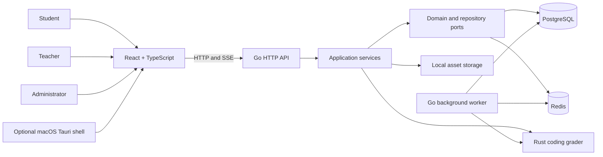
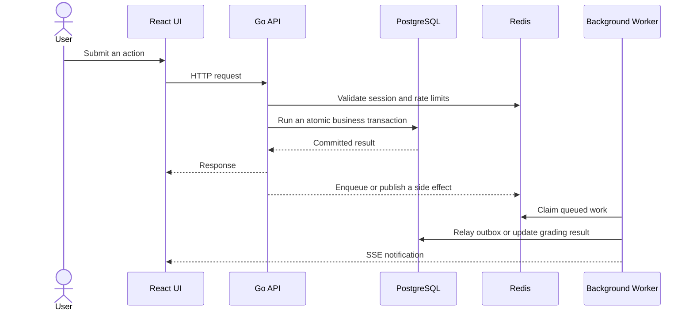

# Vedam LMS

Vedam LMS is a local, full-stack learning management system with separate student and staff experiences. It combines a React web interface, a Go API, PostgreSQL persistence, Redis services, Rust coding tools, and an optional macOS Tauri desktop shell.

The project is designed for local demos and development. It does not provide real payments, email delivery, institutional identity integration, or production-grade remote code execution.

## Contents

- [What You Can Do](#what-you-can-do)
- [System Overview](#system-overview)
- [Technology Stack](#technology-stack)
- [Quick Start](#quick-start)
- [Demo Accounts](#demo-accounts)
- [Project Structure](#project-structure)
- [Development Commands](#development-commands)
- [Configuration](#configuration)
- [Coding Challenges](#coding-challenges)
- [Desktop App](#desktop-app)
- [Testing](#testing)
- [Documentation](#documentation)
- [Safety and Scope](#safety-and-scope)

## What You Can Do

### Students

- Sign in, register, sign out, and change a password.
- Browse semesters, subjects, lectures, lecture notes, attachments, and recordings.
- Mark lectures complete and participate in lecture discussions.
- Submit written or coding assignments and review feedback and grades.
- View attendance, performance summaries, schedules, notices, and invoices.
- Save a profile, coding profile, profile photo, and banner.
- Preview and pay seeded invoices through a clearly labeled simulation.

### Teachers

- Review the staff dashboard and submissions awaiting grading.
- Create and update courses and lectures.
- Publish lecture notes, downloadable resources, recordings, and assignments.
- Grade written submissions and record student attendance.
- Publish class sessions and notices.
- Create coding challenges with public example tests and hidden test cases.

### Administrators

- Perform all teacher operations.
- Create student and teacher accounts.
- Issue invoices and review the fee ledger.
- Manage local staff and student records.

Public registration always creates a student. Staff accounts cannot be created through public registration.

## System Overview





PostgreSQL is the source of truth for users, academic data, submissions, grades, attendance, fees, and sync metadata. Redis provides sessions, rate limiting, cache projections, Pub/Sub notifications, and background streams. Uploaded files are stored on disk.

## Technology Stack

| Area | Technology |
| --- | --- |
| Web UI | React 19, TypeScript, Vite, Tailwind CSS |
| API | Go, `net/http`, PostgreSQL, Redis |
| Database | PostgreSQL 17 |
| Cache and jobs | Redis 7 |
| Code grading | Rust workspace and macOS local sandbox |
| Desktop | Tauri v2 and Rust |
| Offline desktop storage | SQLite through `lms-sync` |
| Editor | CodeMirror |

## Quick Start

### Prerequisites

- Node.js 24 or newer
- Go 1.26 or newer
- Rust and Cargo
- Docker with Docker Compose
- macOS is required for the local Java/Python sandbox

### 1. Start PostgreSQL and Redis

```bash
docker compose up -d
docker compose ps
```

This starts PostgreSQL on `127.0.0.1:5432` and Redis on `127.0.0.1:6379`.

### 2. Configure the environment

```bash
cp .env.example .env
```

The defaults match `docker-compose.yml`. Environment variables override values in `.env`.

### 3. Install dependencies and seed the database

```bash
npm ci
(cd backend && go run ./cmd/seed)
```

The seed command applies database migrations and adds the demo users and local fixtures. Use `--reset` to drop and recreate the application schema:

```bash
(cd backend && go run ./cmd/seed --reset)
```

### 4. Start the development stack

```bash
npm run dev
```

This builds the Rust grader, starts the Go API and worker, and launches Vite.

Open **http://127.0.0.1:5173**.

To build and serve the web app through Go on port `3001`:

```bash
npm run build
npm start
```

Open **http://127.0.0.1:3001**.

Stop development processes with `Ctrl+C`.

## Demo Accounts

| Portal | Email | Password |
| --- | --- | --- |
| Student | `student@vedam.local` | `VedamLocal123!` |
| Teacher | `teacher@vedam.local` | `VedamLocal123!` |
| Administrator | `admin@vedam.local` | `VedamLocal123!` |

These are intentionally public local sample accounts. Demo accounts are disabled in production mode.

The seeded student contains illustrative academic records. A newly registered student starts without attendance, invoices, or results.

## Project Structure

```text
.
├── src/                         # React web UI
│   ├── components/              # Layout, screens, and reusable UI
│   ├── context/                 # LMS application state
│   ├── portal/                  # Student, staff, contest, and coding portals
│   └── data/                    # Seeded UI data and academic helpers
├── backend/
│   ├── cmd/                     # API, worker, seed, and maintenance commands
│   ├── internal/
│   │   ├── domain/              # Entities and repository contracts
│   │   ├── application/         # Commands and workflows
│   │   ├── adapters/            # HTTP, PostgreSQL, Redis, storage, and grader
│   │   └── runtime/             # Dependency and server composition
│   ├── migrations/              # PostgreSQL schema migrations
│   └── internal/seed/           # Demo fixtures
├── crates/
│   ├── lms-grader/              # Rust Java/Python grading binary
│   └── lms-sync/                # Offline SQLite sync engine
├── src-tauri/                   # Native macOS Tauri shell
├── tests/                       # Node.js integration and route tests
├── docs/                        # Architecture and implementation notes
└── docker-compose.yml           # Local PostgreSQL and Redis services
```

## Development Commands

| Command | Purpose |
| --- | --- |
| `npm run dev` | Build the grader and start the API, worker, and Vite |
| `npm run dev:web` | Start only the Vite development server |
| `npm run build` | Type-check and build the web app into `dist/` |
| `npm start` | Build and run the Go API and worker |
| `npm run lint` | Lint TypeScript and JavaScript |
| `npm test` | Run Rust, JavaScript, and Node test suites |
| `npm run desktop:dev` | Run the Tauri desktop app in development |
| `npm run desktop:build` | Build the macOS desktop bundle |

Useful backend commands:

```bash
(cd backend && go run ./cmd/api)
(cd backend && go run ./cmd/worker)
(cd backend && go test ./...)
(cd backend && go run ./cmd/reconcile-assets)
```

## Configuration

Copy `.env.example` to `.env`, then adjust values as needed.

| Variable | Local default | Purpose |
| --- | --- | --- |
| `HTTP_ADDR` | `127.0.0.1:3001` | API and static-app listen address |
| `DATABASE_URL` | Local `lms_dev` PostgreSQL | Application database |
| `TEST_DATABASE_URL` | Local `lms_test` PostgreSQL | Integration test database |
| `REDIS_URL` | `redis://127.0.0.1:6379/0` | Sessions and jobs |
| `ASSET_STORAGE_DIR` | `backend/.data/assets` | Uploaded files |
| `GRADER_BINARY_PATH` | `target/release/lms-grader` | Rust grader binary |
| `SESSION_TTL_HOURS` | `24` | Session lifetime |
| `SESSION_SLIDING` | `false` | Renew sessions on authenticated requests |
| `COOKIE_SECURE` | `false` | Require HTTPS-only session cookies |

The API uses an HttpOnly, SameSite session cookie for web clients. Native clients use bearer authentication and `X-LMS-Auth: bearer`.

For production-shaped configuration, `APP_ENV=production` requires:

- An HTTPS `PUBLIC_ORIGIN`
- `COOKIE_SECURE=true`
- PostgreSQL with `sslmode=verify-full`
- Authenticated TLS Redis with a `rediss://` URL
- A non-demo database password
- Explicit trusted proxy CIDRs when running behind a proxy

Production also disables demo accounts, demo seeding, and the local macOS grader.

## Coding Challenges

Open **Assignments → Solve coding challenge** to use the student workspace. The editor supports Java and Python, saved drafts, example runs, custom input, hidden-test submissions, diagnostics, and submission history.

Java solutions may define:

```java
public class Solution {
    public int[] twoSum(int[] nums, int target) {
        // your solution
    }
}
```

Python solutions may define:

```python
class Solution:
    def twoSum(self, nums, target):
        # your solution
        pass
```

New challenges use `Solution.solve(input)` for Java and Python by default. Hidden tests and expected answers are withheld from student API responses.

The local runner uses an isolated temporary directory and the Rust grader:

- OS sandbox and process restrictions
- CPU and wall-clock limits
- Source, input, output, and concurrency limits
- Separate trusted compilation limits
- Limited Java heap

This is a local teaching runner, not a hardened multi-tenant judge. Public or multi-tenant hosting should use an isolated container or virtual-machine execution provider.

## Desktop App

The macOS Tauri app reuses the React frontend and provides native Keychain storage, notifications, a local SQLite store, and a Rust sync engine.

```bash
npm run desktop:dev
```

The desktop app requires macOS and the same local infrastructure as the web app. Switching accounts revokes the active bearer session.

## Testing

Create the test database once for PostgreSQL integration tests:

```bash
docker compose exec postgres createdb -U lms lms_test
```

Run all tests:

```bash
npm test
(cd backend && go test -race -tags=integration ./...)
```

The integration suite uses disposable Redis instances and temporary PostgreSQL schemas. Set `TEST_REDIS_SERVER` to use a specific Redis executable.

Test categories include:

- Repository and database contracts
- Authentication and role authorization
- Student and staff workflows
- Assignment and submission behavior
- Grading and contest flows
- Sync and payments
- Persistence across API restarts

## Documentation

- [Architecture and SOLID decisions](docs/ARCHITECTURE.md)
- [System design and topology](docs/SYSTEM-DESIGN.md)
- [Phase 1: Go and PostgreSQL](docs/phases/PHASE-1-GO-CORE-AND-POSTGRES.md)
- [Phase 2: API and Redis](docs/phases/PHASE-2-GO-API-REDIS-AND-PARITY.md)
- [Phase 3: Rust grader](docs/phases/PHASE-3-RUST-CODE-GRADER.md)
- [Phase 4: Offline sync](docs/phases/PHASE-4-RUST-OFFLINE-SYNC-ENGINE.md)
- [Phase 5: Tauri app](docs/phases/PHASE-5-MACOS-TAURI-APP.md)
- [Phase 6: Contests](docs/phases/PHASE-6-CONTESTS.md)

## Safety and Scope

Vedam LMS is a demonstration project. It includes:

- Seeded academic records
- Simulated payments and labeled sample receipts
- Local file storage
- Local Java/Python execution on macOS
- Public demo credentials

It does not include real payment processing, real identity verification, email password recovery, external video hosting, institutional data synchronization, or hardened public code execution.
