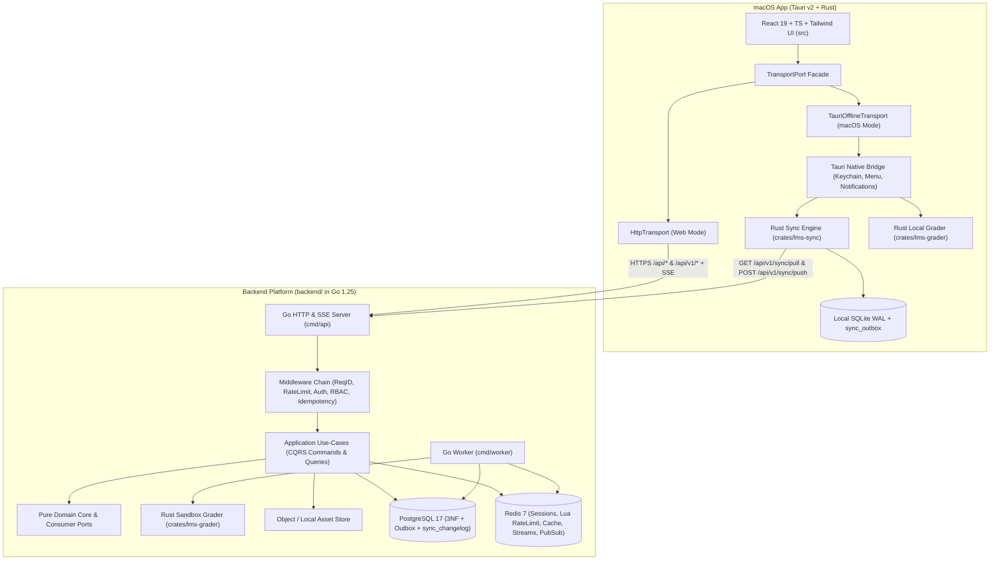
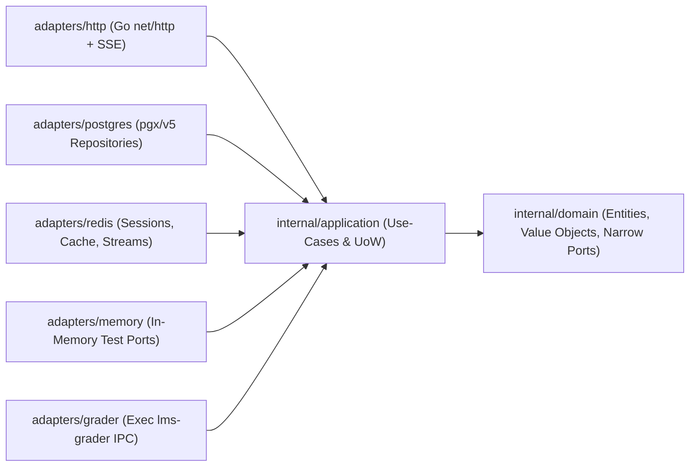

# Vedam LMS — System Design & Master Architecture

> Production architecture blueprint for migrating the local Node.js LMS prototype in [`server/`](file:///Users/sirwagyashekhar/Projects/LMS/server/index.mjs) to a **Go 1.25 + PostgreSQL 17 + Redis 7** backend paired with a **Rust + Tauri v2 + SQLite** offline-first macOS desktop application, sharing the existing **React 19 + TypeScript + Tailwind** UI in [`src/`](file:///Users/sirwagyashekhar/Projects/LMS/src/App.tsx).

---

## 1. Architecture Stack & Layer Responsibilities

| Layer / Component | Language / Stack | Primary Responsibility | Architectural Rationale |
| :--- | :--- | :--- | :--- |
| **Main API & Async Workers** | **Go 1.25 + PostgreSQL 17 + Redis 7** | Normalized academic persistence, auth/RBAC, CQRS bootstrap projections, atomic payments, sync delta log, SSE events | Explicit interfaces (DIP), low-latency concurrency via goroutines & `pgxpool`, single static binary deployment |
| **Code Grader / Sandbox** | **Rust (`crates/lms-grader`)** | Memory-safe compile/execute sandbox for Python & Java (`twoSum`, `isValid`, `solve`, raw stdin) with OS + resource enforcement | RAII sandbox cleanup (`Drop`), zero-overhead process group control, macOS `sandbox-exec` + POSIX `setrlimit` |
| **Offline Storage & Sync Engine** | **Rust (`crates/lms-sync`) + SQLite WAL** | `<1 ms` local reads, transactional mutation `sync_outbox`, idempotent push replay, incremental cursor pull, conflict resolution | Shared Rust domain crate with zero Node/Electron bloat; safe concurrent WAL reads while syncing in background |
| **Desktop App Shell & Native Bridge** | **Rust (Tauri v2, `src-tauri/`)** | Native macOS `.app` window chrome, Keychain credential vault, native notifications, menu shortcuts, typed IPC bridge | Minimal RAM footprint using WKWebView; isolates OS privileges via Tauri v2 least-privilege capability ACLs |
| **Client UI (Web + Desktop)** | **React 19 + TypeScript + Tailwind (`src/`)** | Student workspace, Staff/Admin portals, CodeMirror coding lab, interactive charts | Reuses 100% of existing UI screens via a `TransportPort` facade swapping `fetch` (Web) and Tauri IPC (macOS) |

---

## 2. System Topology & Data Flow



### Hexagonal Dependency Rule

All dependencies point strictly inward toward `internal/domain`:



---

## 3. Target Polyglot Monorepo Structure

```text
LMS/
├── backend/                                # Go 1.25 backend module (go.mod)
│   ├── cmd/
│   │   ├── api/
│   │   │   └── main.go                     # HTTP/SSE API composition root
│   │   └── worker/
│   │       └── main.go                     # Outbox relay & async code grading consumer
│   ├── internal/
│   │   ├── domain/
│   │   │   ├── errs/                       # Typed domain errors (ErrNotFound, ErrConflict, ErrForbidden, etc.)
│   │   │   ├── iam/                        # User, Role, Session, StudentProfile, CodingHandle, PasswordHasher
│   │   │   ├── catalog/                    # Semester, Course, Lecture, Resource, ScheduleSlot, Notice
│   │   │   ├── learning/                   # AttendanceSummary, LectureProgress, Discussion
│   │   │   ├── assessment/                 # Assignment, CodingProblem, TestCase, Submission, CodingAttempt
│   │   │   ├── finance/                    # FeeInvoice, Payment, IdempotencyKey, Receipt
│   │   │   ├── sync/                       # ChangelogEntry, OutboxMutation, CursorWatermark
│   │   │   └── contracttest/               # Liskov Substitution suite executed against PG + Memory adapters
│   │   ├── application/
│   │   │   ├── auth/                       # Login, Register, Logout, ChangePassword
│   │   │   ├── workspace/                  # BootstrapQuery (CQRS projection), ProfileCommand
│   │   │   ├── learning/                   # ToggleProgress, SubmitWritten, Discussions, Assets
│   │   │   ├── coding/                     # EvaluateCode (run/submit), GradingResultUpdater, HistoryQuery
│   │   │   ├── finance/                    # PayInvoiceCommand (UoW), GenerateReceiptQuery
│   │   │   ├── staff/                      # Catalog, Courses, Lectures, Attendance, Grading, AdminUsers, Fees
│   │   │   └── syncsvc/                    # PullDeltaQuery, PushMutationsCommand
│   │   └── adapters/
│   │       ├── postgres/                   # pgxpool, TxUnitOfWork, SQL queries, Outbox + Changelog appender
│   │       ├── memory/                     # Thread-safe in-memory adapters implementing identical ports
│   │       ├── redis/                      # Sessions, Lua sliding-window rate limiter, Cache-Aside, Streams
│   │       ├── grader/                     # Subprocess IPC adapter invoking crates/lms-grader binary
│   │       ├── storage/                    # Local / S3 asset blob adapter (replaces SQLite BYTEA blobs)
│   │       ├── clock/                      # SystemClock & FixedClock for deterministic tests
│   │       └── http/                       # net/http Go 1.22+ ServeMux, middleware chain, handlers, SSE
│   └── migrations/                         # 001_initial_schema.up.sql / .down.sql + seed loader
├── crates/                                 # Cargo Workspace (Cargo.toml)
│   ├── lms-grader/                         # Phase 3: Standalone sandboxed code execution binary + library
│   │   ├── src/
│   │   │   ├── lib.rs
│   │   │   ├── main.rs                     # JSON-over-stdin/stdout CLI entrypoint
│   │   │   ├── strategy.rs                 # Open/Closed LanguageStrategy trait + registry (Python, Java)
│   │   │   ├── harness.rs                  # Platform-owned Solution drivers (twoSum, isValid, solve)
│   │   │   ├── sandbox.rs                  # RAII SandboxDir, macOS sandbox-exec profile, setrlimit, RSS monitor
│   │   │   └── pipeline.rs                 # Template Method JudgePipeline
│   │   └── Cargo.toml
│   └── lms-sync/                           # Phase 4: Offline SQLite WAL store + cursor delta sync engine
│       ├── migrations/
│       │   └── 001_local_sync.sql
│       ├── src/
│       │   ├── lib.rs
│       │   ├── store.rs                    # SQLite WAL read/write adapter + sync_outbox queue
│       │   ├── conflict.rs                 # Server-authoritative & versioned LWW conflict resolver
│       │   ├── remote.rs                   # RemoteSyncClient HTTP trait + reqwest adapter
│       │   └── engine.rs                   # Background Tokio SyncEngine loop + exponential backoff
│       └── Cargo.toml
├── src-tauri/                              # Phase 5: Native macOS Tauri v2 shell
│   ├── capabilities/default.json
│   ├── src/
│   │   ├── main.rs
│   │   ├── lib.rs                          # App builder, custom macOS menu, Keychain + background sync wiring
│   │   ├── keychain.rs                     # macOS Security.framework credential storage
│   │   └── commands.rs                     # Typed #[tauri::command] bridge (API, Offline Sync, Local Grader)
│   ├── tauri.conf.json
│   └── Cargo.toml
├── docs/
│   ├── ARCHITECTURE.md                     # Existing Node prototype architecture notes
│   ├── SYSTEM-DESIGN.md                    # This master specification
│   └── phases/                             # Detailed implementation blueprints (Phases 1–5)
├── src/                                    # React 19 + TypeScript + Tailwind frontend (Web + Tauri)
├── server/                                 # Existing Node prototype (strangled cleanly in Phase 2)
├── docker-compose.yml                      # Local PostgreSQL 17 + Redis 7 services
└── .env.example                            # Documented runtime configuration
```

---

## 4. SOLID Principles Matrix

Every architectural decision resolves specific structural limits observed in the prototype while establishing clean compile-time boundaries across Go, Rust, and TypeScript:

| Principle | Prototype Baseline in `server/` | Production Enforcement in Target Architecture |
| :--- | :--- | :--- |
| **S — Single Responsibility Principle** | [`server/routes/staff-academic.mjs`](file:///Users/sirwagyashekhar/Projects/LMS/server/routes/staff-academic.mjs) mixes HTTP parsing, input validation, mutating in-memory `academic` JSON, and asset decoding. [`server/coding/service.mjs`](file:///Users/sirwagyashekhar/Projects/LMS/server/coding/service.mjs) combines concurrency locks, rate limiting, test filtering, judging, and gradebook updates. | 1. **HTTP handlers** (`adapters/http`): Decode DTOs, call one use-case method, map domain errors to HTTP status.<br>2. **Middleware**: Owns rate-limiting (`LuaRateLimiter`) and auth (`SessionAuthenticator`) exclusively.<br>3. **Use-cases** (`application/*`): Orchestrate business workflows without touching SQL, HTTP, or Redis serialization.<br>4. **AssetStorage**: Stores lecture videos and submission files outside relational tables.<br>5. **`lms-grader` & `lms-sync`**: Separate Rust crates for isolated code execution vs. offline SQLite synchronization. |
| **O — Open/Closed Principle** | Adding a new coding language requires editing [`server/coding/languages.mjs`](file:///Users/sirwagyashekhar/Projects/LMS/server/coding/languages.mjs) plus [`harness.mjs`](file:///Users/sirwagyashekhar/Projects/LMS/server/coding/harness.mjs); supporting real payment gateways requires branching inside [`payments.mjs`](file:///Users/sirwagyashekhar/Projects/LMS/server/domain/payments.mjs). | 1. **Strategy Registry in `lms-grader`**: `LanguageRegistry` maps language IDs to `Box<dyn LanguageStrategy>`. Adding C++20 or Rust submissions registers a new strategy struct without editing `JudgePipeline`.<br>2. **`PaymentGateway` & `PasswordVerifier` traits/interfaces**: Simulated local payments and scrypt legacy hashes swap cleanly for Stripe/Razorpay and Argon2id hashes via constructor injection without altering command handlers.<br>3. **Sync Mutation Handlers**: Server sync processor dispatches `MutationType` through a handler map rather than a growing `switch`. |
| **L — Liskov Substitution Principle** | In [`server/infrastructure/repositories.mjs`](file:///Users/sirwagyashekhar/Projects/LMS/server/infrastructure/repositories.mjs), transactions must be synchronous because `node:sqlite` rejects promises mid-transaction, making async DB adapters non-substitutable. | 1. **`TxManager` (`WithTx(ctx, func(ctx context.Context) error)`)**: Context-scoped unit of work works identically for `pgx.Tx` and in-memory locks.<br>2. **`contracttest` Suite**: Identical test functions in `internal/domain/contracttest` run against both `adapters/postgres` and `adapters/memory` (and `crates/lms-sync` trait mocks vs. real SQLite), proving identical semantics on `ErrNotFound`, `ErrConflict`, and rollback behavior. |
| **I — Interface Segregation Principle** | [`server/index.mjs`](file:///Users/sirwagyashekhar/Projects/LMS/server/index.mjs#L46-L53) merges all repositories, catalog functions, and services into one flat `dependencies` object passed to every route module. | 1. **Consumer-Owned Narrow Go Interfaces**: `StudentAssignmentReader` exposes only `GetPublicAssignment(ctx, id)` (without `hidden` test cases in the return type), while `StaffAssignmentAuthor` exposes `CreateCodingAssignment(ctx, cmd)`.<br>2. **Use-Case Dependencies**: `PayInvoiceHandler` depends only on `InvoiceGetter`, `PaymentRecorder`, `FeeUpdater`, and `TxManager` (1 method each).<br>3. **Rust Traits**: `lms-sync` splits `LocalReadStore`, `OutboxQueue`, and `RemoteTransport` instead of one monolithic `Database` trait. |
| **D — Dependency Inversion Principle** | [`server/domain/workspace.mjs`](file:///Users/sirwagyashekhar/Projects/LMS/server/domain/workspace.mjs) relies on prototype-specific `structuredClone` over catalog state, and [`src/portal/api.ts`](file:///Users/sirwagyashekhar/Projects/LMS/src/portal/api.ts) directly calls global `fetch('/api...')`. | 1. Go `internal/domain` and `internal/application` have **zero imports** from `pgx`, `go-redis`, or `net/http`. Composition happens solely in `cmd/api/main.go` and `cmd/worker/main.go`.<br>2. React UI depends on an explicit `TransportPort` interface backed by `HttpTransport` (Web) or `TauriOfflineTransport` (macOS). |

---

## 5. System Design & GoF Patterns Applied

1. **Hexagonal Architecture (Ports & Adapters)**: Core domain logic sits inside `internal/domain` and `internal/application`; PostgreSQL, Redis, HTTP, S3/filesystem assets, and Rust subprocesses live behind strict ports in `adapters/`.
2. **CQRS (Command Query Responsibility Segregation)**:
   - **Write Model**: Normalized PostgreSQL 3NF tables validate foreign keys, uniqueness, non-overlapping schedule slots, and role constraints.
   - **Read Model**: `WorkspaceBootstrapQuery` projects the exact nested JSON shape required by [`src/data/lmsData.ts`](file:///Users/sirwagyashekhar/Projects/LMS/src/data/lmsData.ts) and [`src/portal/Portal.tsx`](file:///Users/sirwagyashekhar/Projects/LMS/src/portal/Portal.tsx), cached in Redis (`cache:bootstrap:{userId}:v{ver}`) and replicated into Tauri's SQLite database.
3. **Unit of Work + Transactional Outbox Pattern**: Every mutating command executes inside `TxManager.WithTx`, atomically committing domain table writes alongside an `outbox_events` row and a monotonic `sync_changelog` row (`seq BIGSERIAL`). The outbox worker publishes committed events to Redis Pub/Sub and invalidates cached bootstrap keys without dual-write inconsistencies.
4. **Decorator + Singleflight (`golang.org/x/sync/singleflight`)**: `CachedBootstrapService` wraps the PostgreSQL query service with Redis lookup + `singleflight.Group` deduplication so thundering herds (e.g., 500 students refreshing before a deadline) trigger only one SQL read.
5. **Chain of Responsibility**: Go `net/http` middleware pipeline executes `RequestID -> StructuredJSONLogger -> PanicRecovery -> SlidingWindowRateLimit -> SessionAuth -> RequireRole -> IdempotencyKey`.
6. **Template Method + Strategy + RAII (`crates/lms-grader`)**: `JudgePipeline::evaluate` fixes the secure sandbox workflow (`create_temp_sandbox -> generate_harness -> compile_if_needed -> execute_cases -> compute_verdict -> Drop`), delegating compilation/execution flags to `LanguageStrategy` implementations (`PythonStrategy`, `JavaStrategy`). `SandboxDir` implements Rust `Drop` to `SIGKILL` process groups and `remove_dir_all` on every exit or panic path.
7. **Idempotent Mutation Outbox (`crates/lms-sync`)**: Offline edits generate a client `UUIDv7` `idempotency_key` persisted in local SQLite `sync_outbox`. Replayed network calls are deduplicated on the server via Redis/PostgreSQL `UNIQUE(idempotency_key)`.
8. **Strangler Fig Pattern**: Phase 2 serves `/api/*` with byte-compatible status codes and cookies (`lms_session`) alongside `/api/v1/*`, allowing the existing Vite app and verification suites in [`server/*.test.mjs`](file:///Users/sirwagyashekhar/Projects/LMS/server/lms.test.mjs) to run unmodified against Go before removing `server/`.

---

## 6. Non-Functional Targets & Scaling Evolution Triggers

| Dimension | Local / Initial Target | Production Scaling Strategy (Evolution Trigger) |
| :--- | :--- | :--- |
| **API Latency (Cached Reads)** | `< 10 ms` p95 from Redis; `< 2 ms` on macOS local SQLite | Add read-replicas in PostgreSQL (`pgxpool` read/write split) when DB CPU > 65% |
| **Write Throughput & Atomicity** | 100% ACID across payments, submissions, and `sync_changelog` | Partition `sync_changelog` and `coding_attempts` monthly by range when rows > 10M |
| **Code Grader Isolation** | `sandbox-exec` + `setrlimit` on macOS dev (`max 2` concurrent local runs) | Swap `LocalSubprocessGrader` for `RedisStreamGrader` backed by ephemeral Firecracker / Linux cgroup v2 worker pods (`nsjail` / `isolate`) |
| **Realtime Push** | Redis Pub/Sub -> Go SSE (`/api/v1/events`) | Horizontally scale stateless `cmd/api` instances behind an L7 load balancer with sticky/TLS termination; Redis Pub/Sub fans out across nodes |
| **Binary Assets (PDF/MP4)** | Local directory `backend/.data/assets` via `AssetStore` port | Swap `LocalAssetStore` for `S3AssetStore` returning pre-signed URLs without touching HTTP routes |

---

## 7. Implementation Phase Roadmap

1. **[Phase 1 — Infrastructure & Go Core Domain](file:///Users/sirwagyashekhar/Projects/LMS/docs/phases/PHASE-1-GO-CORE-AND-POSTGRES.md)**
   - Homebrew `postgresql@17` + `redis` setup, `docker-compose.yml`, 3NF migrations, Go Hexagonal domain entities, narrow ports, Unit of Work, seed importer, and LSP `contracttest` suite.
2. **[Phase 2 — Go HTTP/SSE API, Redis Services & Strangler Parity](file:///Users/sirwagyashekhar/Projects/LMS/docs/phases/PHASE-2-GO-API-REDIS-AND-PARITY.md)**
   - Complete `/api/*` + `/api/v1/*` HTTP handlers, Redis sessions & Lua rate-limiter, `singleflight` caching, Outbox worker, SSE stream, integration parity verification, and retirement of `server/`.
3. **[Phase 3 — Rust Sandboxed Code Grader (`crates/lms-grader`)](file:///Users/sirwagyashekhar/Projects/LMS/docs/phases/PHASE-3-RUST-CODE-GRADER.md)**
   - Strategy registry (`python`, `java`, extensible), Template Method judge pipeline, `Solution` harnesses (`twoSum`, `isValid`, `solve`), RAII `sandbox-exec` + `setrlimit` isolation, and Go worker integration.
4. **[Phase 4 — Rust Offline Storage & Sync Engine (`crates/lms-sync`)](file:///Users/sirwagyashekhar/Projects/LMS/docs/phases/PHASE-4-RUST-OFFLINE-SYNC-ENGINE.md)**
   - SQLite WAL local schema, outbox mutation queue, delta cursor pull, idempotent push, exponential backoff, and conflict resolver.
5. **[Phase 5 — Native macOS Tauri v2 App & Frontend TransportPort](file:///Users/sirwagyashekhar/Projects/LMS/docs/phases/PHASE-5-MACOS-TAURI-APP.md)**
   - `TransportPort` abstraction in `src/portal/api.ts`, Tauri v2 macOS shell (`src-tauri/`), Keychain vault, overlay titlebar integration in `TopHeader.tsx`, native notifications, and `.app` / `.dmg` packaging.
