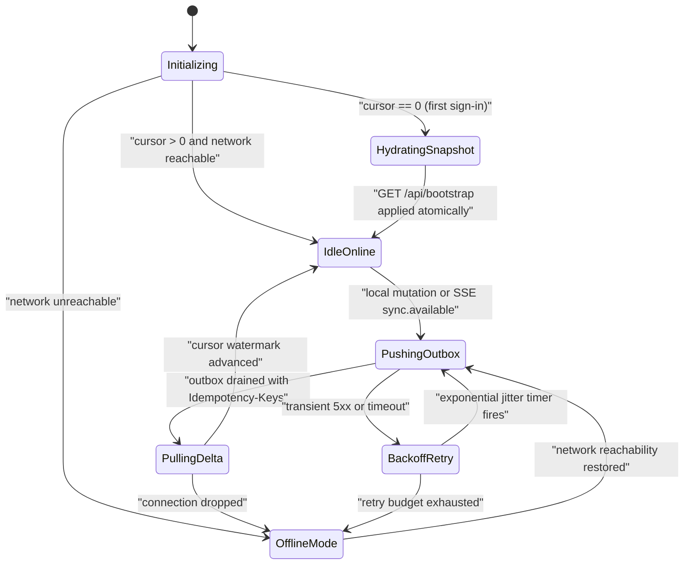

# Phase 4 — Rust Offline Storage & Delta Sync Engine (`crates/lms-sync`)

> **Prerequisite**: [Phase 2](file:///Users/sirwagyashekhar/Projects/LMS/docs/phases/PHASE-2-GO-API-REDIS-AND-PARITY.md) (`/api/v1/sync/pull` & `/api/v1/sync/push` live on Go backend).
> **Phase Goal**: Build `crates/lms-sync`, a standalone Rust + SQLite WAL library powering sub-millisecond local UI reads, crash-safe `sync_outbox` mutation queuing, incremental cursor synchronization, and deterministic conflict resolution when offline on macOS.


## Implementation status

The workspace now includes `lms-sync`. The SQLite file belongs to one account and preserves optimistic profile, progress and discussion edits, conflicts, and written and code drafts across restarts. The reqwest client uses Phase 2's per-item idempotency keys. The engine also exposes status updates and a wake signal for the host's reconnect and SSE handling.

Profile, progress and discussion edits can sync against the existing Go API. Queued written and coding submissions still need a server contract that can safely replay submissions and enforce the grading lock. SSE connection ownership and UI wiring are part of the Phase 5 host.

Run `cargo test -p lms-sync --locked` for local tests. For the end-to-end case, set `LMS_SYNC_TEST_URL` to the origin of a seeded disposable Go API and run `cargo test -p lms-sync --locked --test live_api -- --ignored`.

---

## 1. Sync Lifecycle & Sequence Architecture

### 1.1 Sync Engine State Machine



### 1.2 Offline Edit & Reconnect Flow

```mermaid
sequenceDiagram
    participant UI as "React UI"
    participant Store as "SQLite WAL Store"
    participant Outbox as "sync_outbox Table"
    participant Engine as "Rust SyncEngine"
    participant API as "Go Backend API"

    UI->>Store: "Toggle lecture progress or edit profile (offline)"
    Store->>Store: "Update local read projection immediately"
    Store->>Outbox: "INSERT pending mutation (UUIDv7 idempotency_key, base_version)"
    Store-->>UI: "Optimistic success (<1 ms) + badge: 1 pending"

    Note over Engine,API: "Network reconnects"
    Engine->>Outbox: "Select oldest pending batch (LIMIT 50)"
    Engine->>API: "POST /api/v1/sync/push (mutations + Idempotency-Keys)"
    API-->>Engine: "applied / conflict status per mutation"
    Engine->>Outbox: "DELETE applied items; record conflicts if rejected"
    Engine->>API: "GET /api/v1/sync/pull?cursor=N"
    API-->>Engine: "ChangelogEntry[] + nextCursor"
    Engine->>Store: "Apply delta + update last_seq inside single SQLite Tx"
    Engine-->>UI: "Emit tauri://sync-updated event"
```

---

## 2. Local SQLite WAL Schema (`crates/lms-sync/migrations/001_local_sync.sql`)

```sql
PRAGMA journal_mode = WAL;
PRAGMA synchronous = NORMAL;
PRAGMA foreign_keys = ON;
PRAGMA busy_timeout = 5000;

-- Tracks current authenticated account, cursor watermark, and sync status
CREATE TABLE IF NOT EXISTS sync_meta (
    key         TEXT PRIMARY KEY,
    value       TEXT NOT NULL,
    updated_at  TEXT NOT NULL
);

-- Latest hydrated CQRS snapshot & incremental entity mirrors
CREATE TABLE IF NOT EXISTS workspace_snapshot (
    user_id     TEXT PRIMARY KEY,
    payload     TEXT NOT NULL,
    version     INTEGER NOT NULL DEFAULT 1,
    updated_at  TEXT NOT NULL
);

CREATE TABLE IF NOT EXISTS cached_discussions (
    id          TEXT PRIMARY KEY,
    lecture_id  INTEGER NOT NULL,
    user_id     TEXT NOT NULL,
    author_name TEXT NOT NULL,
    body        TEXT NOT NULL,
    created_at  TEXT NOT NULL,
    pending     INTEGER NOT NULL DEFAULT 0
);
CREATE INDEX IF NOT EXISTS idx_cached_discussions_lecture
    ON cached_discussions(lecture_id, created_at ASC);

CREATE TABLE IF NOT EXISTS local_code_drafts (
    assignment_id TEXT NOT NULL,
    language      TEXT NOT NULL CHECK (language IN ('python', 'java')),
    source        TEXT NOT NULL,
    updated_at    TEXT NOT NULL,
    PRIMARY KEY (assignment_id, language)
);

CREATE TABLE IF NOT EXISTS cached_assets (
    asset_id    TEXT PRIMARY KEY,
    filename    TEXT NOT NULL,
    mime_type   TEXT NOT NULL,
    local_path  TEXT NOT NULL,
    byte_size   INTEGER NOT NULL,
    cached_at   TEXT NOT NULL
);

-- Transactional client mutation outbox
CREATE TABLE IF NOT EXISTS sync_outbox (
    id              TEXT PRIMARY KEY,
    idempotency_key TEXT NOT NULL UNIQUE,
    entity_type     TEXT NOT NULL,
    entity_id       TEXT NOT NULL,
    endpoint_method TEXT NOT NULL,
    endpoint_path   TEXT NOT NULL,
    base_version    INTEGER NOT NULL DEFAULT 0,
    payload_json    TEXT NOT NULL,
    retry_count     INTEGER NOT NULL DEFAULT 0,
    next_retry_at   TEXT NULL,
    last_error      TEXT NULL,
    status          TEXT NOT NULL DEFAULT 'pending' CHECK (status IN ('pending', 'inflight', 'failed')),
    created_at      TEXT NOT NULL
);
CREATE INDEX IF NOT EXISTS idx_sync_outbox_pending
    ON sync_outbox(status, next_retry_at, created_at ASC);

-- Surfaces unresolvable version mismatches to the user without data loss
CREATE TABLE IF NOT EXISTS sync_conflicts (
    id              TEXT PRIMARY KEY,
    entity_type     TEXT NOT NULL,
    entity_id       TEXT NOT NULL,
    local_payload   TEXT NOT NULL,
    server_payload  TEXT NOT NULL,
    reason          TEXT NOT NULL,
    resolved        INTEGER NOT NULL DEFAULT 0,
    created_at      TEXT NOT NULL
);
```

---

## 3. SOLID Trait Boundaries (`crates/lms-sync/src/`)

### 3.1 `Cargo.toml`

```toml
[package]
name = "lms-sync"
version = "0.1.0"
edition = "2024"

[dependencies]
async-trait = "0.1"
chrono = { version = "0.4", features = ["serde"] }
rand = "0.8"
reqwest = { version = "0.12", default-features = false, features = ["json", "rustls-tls"] }
rusqlite = { version = "0.32", features = ["bundled"] }
serde = { version = "1.0", features = ["derive"] }
serde_json = "1.0"
thiserror = "2.0"
tokio = { version = "1.41", features = ["sync", "time", "macros", "rt-multi-thread"] }
uuid = { version = "1.11", features = ["v7", "serde"] }
```

### 3.2 Segregated Traits & Sync Engine (`src/ports.rs` & `src/engine.rs`)

```rust
use async_trait::async_trait;
use serde::{Deserialize, Serialize};
use serde_json::Value;

#[derive(Debug, Clone, Serialize, Deserialize)]
#[serde(rename_all = "camelCase")]
pub struct OutboxMutation {
    pub id: String,
    pub idempotency_key: String,
    pub entity_type: String,
    pub entity_id: String,
    pub endpoint_method: String,
    pub endpoint_path: String,
    pub base_version: i64,
    pub payload_json: Value,
    pub retry_count: u32,
}

#[derive(Debug, Clone, Deserialize)]
#[serde(rename_all = "camelCase")]
pub struct PushItemOutcome {
    pub idempotency_key: String,
    pub status: String, // "applied" | "conflict" | "rejected"
    pub server_version: Option<i64>,
    pub server_payload: Option<Value>,
    pub reason: Option<String>,
}

#[derive(Debug, Clone, Deserialize)]
#[serde(rename_all = "camelCase")]
pub struct ChangelogEntry {
    pub seq: i64,
    pub scope: String,
    pub entity_type: String,
    pub entity_id: String,
    pub op: String,
    pub payload: Value,
}

#[derive(Debug, Clone, Deserialize)]
#[serde(rename_all = "camelCase")]
pub struct PullResponse {
    pub cursor: i64,
    pub has_more: bool,
    pub entries: Vec<ChangelogEntry>,
}

#[derive(Debug, Clone, Serialize)]
#[serde(rename_all = "camelCase")]
pub struct SyncStatusSnapshot {
    pub state: String, // "synced" | "syncing" | "offline" | "error"
    pub pending_count: usize,
    pub conflict_count: usize,
    pub last_synced_at: Option<String>,
    pub cursor: i64,
}

#[derive(Debug, thiserror::Error)]
pub enum SyncError {
    #[error("sqlite storage error: {0}")]
    Storage(#[from] rusqlite::Error),
    #[error("network unavailable: {0}")]
    Network(String),
    #[error("unauthorized session")]
    Unauthorized,
    #[error("serialization error: {0}")]
    Json(#[from] serde_json::Error),
}

pub trait LocalStorePort: Send + Sync {
    fn get_bootstrap_json(&self, user_id: &str) -> Result<Option<Value>, SyncError>;
    fn save_bootstrap_json(&self, user_id: &str, snapshot: &Value, cursor: i64) -> Result<(), SyncError>;
    fn enqueue_optimistic_mutation(
        &self,
        user_id: &str,
        mutation: &OutboxMutation,
        updated_snapshot: Option<&Value>,
    ) -> Result<(), SyncError>;
    fn pending_mutations(&self, limit: usize) -> Result<Vec<OutboxMutation>, SyncError>;
    fn mark_applied(&self, idempotency_key: &str) -> Result<(), SyncError>;
    fn schedule_retry(&self, idempotency_key: &str, next_retry_rfc3339: &str, err: &str) -> Result<(), SyncError>;
    fn record_conflict(&self, entity_type: &str, entity_id: &str, local: &Value, server: &Value, reason: &str) -> Result<(), SyncError>;
    fn apply_changelog(&self, user_id: &str, next_cursor: i64, entries: &[ChangelogEntry]) -> Result<(), SyncError>;
    fn current_cursor(&self) -> Result<i64, SyncError>;
    fn status_snapshot(&self) -> Result<SyncStatusSnapshot, SyncError>;
}

#[async_trait]
pub trait RemoteSyncPort: Send + Sync {
    async fn fetch_bootstrap(&self, bearer_token: &str) -> Result<Value, SyncError>;
    async fn push_mutations(&self, bearer_token: &str, batch: &[OutboxMutation]) -> Result<Vec<PushItemOutcome>, SyncError>;
    async fn pull_delta(&self, bearer_token: &str, cursor: i64, limit: usize) -> Result<PullResponse, SyncError>;
}
```

---

## 4. Conflict Resolution Matrix & Backoff Strategy

| Entity Type | Editable Offline on macOS? | Authoritative Source | Resolution Rule |
| :--- | :--- | :--- | :--- |
| **Student Profile & Coding Handles** | Yes | Versioned Optimistic Lock | If `base_version == server_version`, apply & bump version; if mismatched, store both payloads in `sync_conflicts` and preserve user's unsent copy for explicit merge |
| **Lecture Progress (`complete`)** | Yes | Idempotent Set Union | `INSERT OR IGNORE` / `DELETE`; last client timestamp wins cleanly |
| **Lecture Discussion Posts** | Yes | Append-Only (`UUIDv7`) | Always applies as a new ordered message (zero conflicts) |
| **Local Code Editor Drafts** | Yes | Device-Local SQLite | Saved instantly to `local_code_drafts`; never lost on crash or offline sleep |
| **Written & Coding Submissions** | Draft locally; queue submit | Server Gate | Queued `submit` checks server lock (`score IS NULL`); rejects cleanly if already graded |
| **Fee Payments & Grades & Attendance** | No (Online-required for Pay) | **100% Server-Authoritative** | Local UI requires online confirmation (`POST /api/payments`) and strictly overwrites local cache from server deltas |

### Exponential Backoff with Full Jitter

```rust
pub fn compute_backoff_ms(retry_count: u32, jitter_unit: f64) -> u64 {
    let base_ms: u64 = 1_000;
    let max_ms: u64 = 300_000; // 5 minutes ceiling
    let exp = base_ms.saturating_mul(1u64 << retry_count.min(9));
    let capped = exp.min(max_ms) as f64;
    (capped * (0.5 + 0.5 * jitter_unit.clamp(0.0, 1.0))) as u64
}
```

---

## 5. Phase 4 Deliverables & Verification Gate

- **Deliverables**:
  - `crates/lms-sync/Cargo.toml`
  - `crates/lms-sync/migrations/001_local_sync.sql`
  - `crates/lms-sync/src/{lib,ports,sqlite_store,remote_http,conflict,engine}.rs`
- **Test Scenarios (`cargo test -p lms-sync`)**:
  1. `offline_toggle_progress_updates_local_snapshot_and_enqueues_outbox`
  2. `push_replay_is_idempotent_under_duplicate_acks`
  3. `version_conflict_records_conflict_row_without_discarding_local_edit`
  4. `pull_delta_advances_cursor_atomically`
  5. `transient_503_schedules_bounded_exponential_backoff`
- **Verification Command**:
  ```bash
  cargo test -p lms-sync
  ```
